<p align="center">
  
</p>

<p align="center">
  
  
  
  
</p>

<p align="center">
  <b><a href="https://maristelaoliveira.github.io/Preparatorio-AWS/">🌐 Abrir o site</a></b>
  &nbsp;·&nbsp;
  <b><a href="https://maristelaoliveira.github.io/Preparatorio-AWS/#proximo">📅 Ver o próximo encontro</a></b>
  &nbsp;·&nbsp;
  <b><a href="https://maristelaoliveira.github.io/Preparatorio-AWS/#treinos">🎯 Ir direto para os treinos</a></b>
</p>

---

## `$ aws sts get-caller-identity`


```json
{
    "UserId": "STELA",
    "Account": "Senac-DF",
    "Arn": "arn:aws:iam::senac-df:user/profa-maristela"
}
```

Prazer, eu sou a **Profa. Maristela**, ou só **Stela**! 👋 Esse memoji sou eu. Se ele aparecer no Teams ou no e-mail, pode confiar: não é phishing. 😉

Boas-vindas ao preparatório **AWS Cloud Foundations** da **AWS Academy da Faculdade de Tecnologia e Inovação Senac-DF**.

Este repositório é o **site do preparatório**: o lugar onde ficam o cronograma, os vídeos, os treinos e o caminho até a prova. Nada de slides: aqui a aula é o próprio site.

O lema é curto: **teoria em casa, prática no sábado.** Os encontros são ao vivo, no Teams, em sábados alternados, das 8h30 às 11h50.

```text
aluno@aws:~$ aws cloudformation deploy --stack-name certificacao
Criando a pilha da sua certificação…

 ✓  Conceitos de nuvem           CREATE_COMPLETE
 ✓  Segurança e conformidade     CREATE_COMPLETE
 ✓  Tecnologia e serviços        CREATE_COMPLETE
 ✓  Cobrança, preços e suporte   CREATE_COMPLETE
 ★  Cloud Practitioner           você chegou!
```

> ☁️ "A nuvem é só o computador de outra pessoa." Verdade. Mas é um computador com zonas de disponibilidade, auto scaling e uma fatura que chega todo mês. Por isso a gente estuda cobrança também. 💸

---

## 🧭 O que tem no site

| | Seção | Para que serve |
|:-:|---|---|
| 📅 | **Próximo encontro** | Mostra sozinho o próximo sábado, pela data de hoje, e o que fazer antes de vir. |
| 🗺️ | **Cronograma** | Os 10 encontros do semestre, com laboratório, desafio e tarefas da quinzena. A cor indica o domínio da prova. |
| ✅ | **Meu progresso** | Você marca os módulos concluídos na AWS Academy e as etapas da reta final. Fica salvo no seu navegador. |
| 🎬 | **Vídeos de apoio** | Pílulas de 8 a 12 minutos com o essencial de cada módulo, demonstração no console e as pegadinhas de prova. |
| 🎯 | **Treinos rápidos** | "Qual é o serviço?" e o mini-simulado Cloud Practitioner, com explicação em cada resposta. |
| 🎫 | **Prova e voucher** | O passo a passo da AWS Academy até o agendamento na Pearson VUE. |
| 🔐 | **Área da turma** | Links do Teams e das gravações. Só abrem com a conta institucional do Senac. |
| 🔗 | **Links** | AWS Academy, AWS Skill Builder, página oficial da certificação e AWS Pricing Calculator. |

Quer guardar o progresso na nuvem? Use o botão **Entrar**, no topo. É **opcional**: sem login, tudo continua funcionando no seu navegador.

---

## 🗓️ Os encontros

Dez sábados, um módulo por quinzena. Em linguagem de nuvem:

```text
aluno@aws:~$ aws s3 ls s3://preparatorio-aws/encontros/
2026-08-01   01-conceitos-de-nuvem/
2026-08-15   02-economia-e-cobranca/
2026-08-29   03-infraestrutura-global-e-seguranca/
2026-09-12   04-redes-e-entrega-de-conteudo/
2026-09-26   05-computacao/
2026-10-10   06-armazenamento/
2026-10-24   07-bancos-de-dados/
2026-11-07   08-well-architected/
2026-11-21   09-escalabilidade-e-monitoramento/
2026-12-05   10-simulado-final/
```

| Nº | Data | Encontro | Laboratório | Desafio |
|:-:|:-:|---|---|---|
| 01 | 01/08 | Boas-vindas e conceitos de nuvem | Tour pelo console no Learner Lab | Nuvem no dia a dia |
| 02 | 15/08 | Economia e cobrança na nuvem | AWS Pricing Calculator; painel de faturamento e planos de suporte | Desafio do orçamento |
| 03 | 29/08 | Infraestrutura global e segurança | Introdução ao IAM | Quem é responsável? |
| 04 | 12/09 | Redes e entrega de conteúdo | Criar a VPC e lançar um servidor web | Arquitetura no quadro |
| 05 | 26/09 | Computação na nuvem | Introdução ao Amazon EC2 | Corrida "Qual serviço?" e simulado parcial dos módulos 1 a 6 |
| 06 | 10/10 | Armazenamento | Amazon EBS; bucket no Amazon S3 | Escolha certa: S3, EBS, EFS ou Glacier |
| 07 | 24/10 | Bancos de dados | Servidor de banco de dados com Amazon RDS | Escolha certa: RDS, Aurora, DynamoDB ou Redshift |
| 08 | 07/11 | Arquitetura: Well-Architected | Análise de arquiteturas reais | Projeto relâmpago para um órgão público de Brasília |
| 09 | 21/11 | Escalabilidade, monitoramento e revisão | Load balancing, Auto Scaling e CloudWatch | Jeopardy da nuvem |
| 10 | 05/12 | Simulado final e caminho até a prova | Simulado completo com tempo de prova | Correção por domínio |

---

## 🎯 Os treinos

São dois, e você pode treinar quantas vezes quiser. Cada resposta mostra na hora o que está certo e o porquê.

- **Qual é o serviço?** São 18 necessidades do dia a dia para você escolher o serviço da AWS que resolve. Guardar arquivos com alta durabilidade? Rodar código só quando um evento acontece? Receber recomendações de custo e segurança?
- **Mini-simulado Cloud Practitioner:** 6 questões no estilo da prova, sobre responsabilidade compartilhada, opções de compra do EC2, zonas de disponibilidade, custos, menor privilégio e Well-Architected.

> 🕵️ **"As questões são as da prova?"**
> Não, e isso é bom! Todas foram escritas para o curso. Questões vazadas da prova ("dumps") violam as regras da certificação, podem custar o seu resultado e, de quebra, costumam ter gabarito errado. Para treinar com material oficial, use o **conjunto oficial de questões práticas**, gratuito no AWS Skill Builder.

---

## 🎫 Da AWS Academy até a prova

A certificação de referência é a **AWS Certified Cloud Practitioner (CLF-C02)**: **65 questões em 90 minutos**, com nota mínima de **700 de 1000**.

| Domínio | Peso |
|---|:-:|
| Conceitos de nuvem | 24% |
| Segurança e conformidade | 30% |
| Tecnologia e serviços | 34% |
| Cobrança, preços e suporte | 12% |

```text
aluno@aws:~$ aws certificacao caminho --até prova
 1. Conclua o Cloud Foundations      módulos, laboratórios e exame final na AWS Academy
 2. Reforce no Skill Builder          Cloud Practitioner Essentials e questões práticas, gratuitos
 3. Crie a conta de certificação      no portal de certificação da AWS
 4. Use o voucher                     no agendamento com a Pearson VUE (não compartilhe o código!)
 5. Escolha o formato                 presencial ou online, com câmera e documento com foto
 6. Divulgue sua conquista            badge digital no LinkedIn e no currículo 🏅
```

> Confira sempre a página oficial da certificação antes de agendar: a AWS atualiza a prova de tempos em tempos.

---

## 🛠️ Ferramentas

<p align="center">
  
</p>

| Ferramenta | Para quê |
|---|---|
| 🎓 **AWS Academy** | Os módulos do Cloud Foundations, os laboratórios e o Learner Lab. |
| 📘 **AWS Skill Builder** | O curso Cloud Practitioner Essentials e o conjunto oficial de questões práticas, ambos gratuitos. |
| 🧮 **AWS Pricing Calculator** | Estimar custos, como no desafio do orçamento. |
| 💬 **Microsoft Teams** | Os encontros ao vivo, as gravações e os avisos da turma. |
| 📅 **Pearson VUE** | O agendamento da prova, presencial ou online. |

O site é feito com HTML, CSS e JavaScript puros, sem framework e sem build. O login opcional usa o Supabase.

---

## 🤖 IA com consciência

A IA pode explicar um serviço, montar um resumo ou criar perguntas para você treinar. Mas quem confere é você: compare sempre com a documentação da AWS e com o material da AWS Academy. Na prova não tem IA. E nem precisa: quem entende o conceito acerta a questão. 💪

```text
aluno@aws:~$ aws iam simulate-principal-policy --acao "colar resposta da IA sem ler"
EvalDecision: explicitDeny ❌
```

---

## 🙋 Dicas de sobrevivência

1. **Faça a tarefa da quinzena antes do sábado.** O encontro é para praticar, não para ver a teoria pela primeira vez.
2. **Desligue o que você ligou no laboratório.** Na nuvem de verdade, instância esquecida vira fatura. 💸
3. **Responsabilidade compartilhada cai muito.** A AWS cuida da segurança **da** nuvem; você cuida da segurança **na** nuvem.
4. **Pricing Calculator estima o futuro; Cost Explorer analisa o passado.** Essa pegadinha aparece. 😉
5. **Nunca use a conta raiz no dia a dia.** Menor privilégio, sempre.
6. **Travou?** Pergunte no Teams. Ninguém nasce sabendo a diferença entre região e zona de disponibilidade.

---

<details>
<summary><b>👩‍🏫 Para a professora (estrutura e como atualizar)</b></summary>

<br>

Site estático publicado no GitHub Pages a partir da branch `main`, pasta raiz, sem build.

```text
Preparatorio-AWS/
├── index.html        # a página do preparatório; os dados ficam no bloco "DADOS (edite aqui)" do script
├── painel.html       # painel da turma (para a professora, com login)
├── css/
│   └── aws.css       # os componentes deste preparatório
├── js/
│   ├── modulos.js    # os módulos do "Meu progresso" (usados pelo index.html e pelo painel.html)
│   ├── conta.js      # login opcional (Supabase)
│   └── painel.js     # o painel da turma
└── assets/
    ├── css/  js/     # estilo.css, neon.css, placa.js e matrix.js: visual comum dos sites da Stela (não editar aqui)
    └── img/          # ícones, logo, memoji e o banner deste README
```

- **Datas e encontros:** lista `ENCONTROS` no script do `index.html`.
- **Vídeos:** lista `VIDEOS`; os links das gravações vão em `VIDEOS_LINKS` (vídeo sem link aparece como "Em breve").
- **Treinos:** listas `SERVICOS` ("Qual é o serviço?") e `QUIZ` (mini-simulado).
- **Links públicos:** lista `LINKS_TURMA`.
- **Área da turma:** lista `AREA_TURMA`. Não há senha: os links só abrem com a conta institucional.
- **Módulos do progresso:** `js/modulos.js`.
- **Novo semestre:** atualize as datas em `ENCONTROS` e os links da área da turma.
- **Antes de publicar:** testar no navegador, também na largura de celular (390 px).

</details>

---

<p align="center">
  Feito com ♥ e sucata eletrônica pela <a href="https://maristelaoliveira.github.io/">Profa. Maristela</a> · AWS Academy da Faculdade de Tecnologia e Inovação Senac-DF
  <br>
  <code>aws configure set estudo ligado</code>
</p>
